# База данных: модель, ERD и доказательство 3НФ

Схема описана в [`prisma/schema.prisma`](../prisma/schema.prisma) и применяется
последовательностью миграций:

| Миграция | Содержимое |
| --- | --- |
| `20261031120000_init` | расширения `citext`, `pg_trgm`; 50 таблиц; PK, FK, UNIQUE, индексы |
| `20261031120100_constraints_and_views` | CHECK-ограничения, триггеры поискового индекса, views, materialized views, функции обновления |
| `20261101000000_analytics_refreshed_at` | колонка `refreshed_at` в двух materialized views аналитики |
| `20261101120000_nomenclature` | номенклатурная классификация: `nomenclature_sections`, `nomenclature_types`, `nomenclature_type_sections`, ссылка из `products` |
| `20261101170000_real_registry` | поля записей государственного реестра в `products` и `manufacturers`; три внешних ключа `products` и `manufacturers.country_id` стали необязательными (ADR 0010) |
| `20261101180000_registry_date_anomalies` | `products_registration_period_check` снят для записей, загруженных из реестра |
| `20261101190000_views_tolerate_registry_gaps` | справочники в `product_catalog_view` присоединяются внешним JOIN; доли в аналитике считаются по изделиям с известным происхождением |
| `20261101200000_registry_integrity` | один незавершённый запуск на источник (частичный UNIQUE); cancelled/invalid учитываются в проблемных изделиях |
| `20261101210000_system_dictionaries` | 68 системных значений справочников для production без демонстрационного seed |

Регистрационная запись сопоставляется по `external_registry_id`; конфликт
уникального регистрационного номера фиксируется отдельно и не сливает разные
изделия. Производители внешнего источника получают детерминированный UUID из
точного имени и адреса; отсутствие производителя не объединяет все записи в
одного выдуманного поставщика. Статус и событие истории меняются под блокировкой
строки в одной транзакции; начальное событие означает время наблюдения, а не
придуманную дату действия статуса в прошлом.

Новые внешние атрибуты атомарны; категория, происхождение, риск и страна
остаются внешними ключами даже когда значение неизвестно. Номенклатурные виды,
разделы и их связь — отдельные отношения. JSON-колонок и сохраняемых рейтингов,
счётчиков отзывов или диапазонов цен в базовых таблицах по-прежнему нет.
Nullable FK и SQL-миграция значений справочников не меняют функциональные
зависимости и не нарушают приведённое ниже доказательство 3НФ.

Применение с нуля — одной командой:

```bash
npm run db:migrate:deploy
```

Всего 53 отношения: 18 справочников и 35 таблиц предметной области.
Производные величины хранятся только в представлениях (раздел
«[Производные представления](#производные-представления)»).

---

## ERD

Диаграмма разбита по предметным областям — целиком 50 сущностей нечитаемы.
Справочники обозначены суффиксом комментария `(справочник)`.

### 1. Пользователи, роли и доступ

```mermaid
erDiagram
  account_statuses ||--o{ users : "статус аккаунта"
  users ||--o{ user_roles : "имеет"
  roles ||--o{ user_roles : "назначена"
  users ||--o{ refresh_tokens : "владеет"
  refresh_tokens |o--o| refresh_tokens : "replaced_by"
  users ||--o{ password_reset_tokens : "владеет"

  account_statuses {
    uuid id PK
    varchar code UK "active | blocked | pending"
    varchar name
  }
  roles {
    uuid id PK
    varchar code UK "user | organization | government | admin"
    varchar name
  }
  users {
    uuid id PK
    citext email UK
    text password_hash
    varchar display_name
    uuid account_status_id FK
    timestamptz email_verified_at
    timestamptz created_at
    timestamptz updated_at
  }
  user_roles {
    uuid user_id PK_FK
    uuid role_id PK_FK
    timestamptz assigned_at
  }
  refresh_tokens {
    uuid id PK
    uuid user_id FK
    varchar token_hash UK "sha256, не сам токен"
    timestamptz expires_at
    timestamptz revoked_at
    uuid replaced_by_id FK_UK
    varchar user_agent
    varchar ip_hash
    timestamptz created_at
  }
  password_reset_tokens {
    uuid id PK
    uuid user_id FK
    varchar token_hash UK
    timestamptz expires_at
    timestamptz used_at
    timestamptz created_at
  }
```

### 2. География и организации

```mermaid
erDiagram
  countries ||--o{ regions : "содержит"
  regions ||--o{ cities : "содержит"
  cities |o--o{ organizations : "расположена"
  organization_types ||--o{ organizations : "тип"
  organization_verification_statuses ||--o{ organizations : "статус проверки"
  organizations ||--o{ organization_members : "состав"
  users ||--o{ organization_members : "участие"
  organization_member_roles ||--o{ organization_members : "роль в организации"
  organizations |o--o| suppliers : "является поставщиком"

  countries {
    uuid id PK
    char iso2 UK
    varchar name UK
  }
  regions {
    uuid id PK
    uuid country_id FK
    varchar code "UK вместе с country_id"
    varchar name
  }
  cities {
    uuid id PK
    uuid region_id FK
    varchar name "UK вместе с region_id"
  }
  organization_types {
    uuid id PK
    varchar code UK "medical | government | supplier | manufacturer"
    varchar name
  }
  organization_verification_statuses {
    uuid id PK
    varchar code UK "pending | verified | rejected | suspended"
    varchar name
  }
  organizations {
    uuid id PK
    uuid organization_type_id FK
    uuid verification_status_id FK
    varchar name
    varchar short_name
    varchar inn UK "NULL допустим"
    varchar ogrn UK "NULL допустим"
    uuid city_id FK
    varchar address
    timestamptz created_at
    timestamptz updated_at
  }
  organization_member_roles {
    uuid id PK
    varchar code UK "member | manager | reviewer | analyst | administrator"
    varchar name
  }
  organization_members {
    uuid organization_id PK_FK
    uuid user_id PK_FK
    uuid member_role_id FK
    timestamptz joined_at
    timestamptz verified_at
  }
  suppliers {
    uuid id PK
    uuid organization_id FK_UK
    varchar license_number
    timestamptz created_at
  }
```

### 3. Каталог, характеристики, цены и аналоги

```mermaid
erDiagram
  manufacturers ||--o{ products : "выпускает"
  countries ||--o{ manufacturers : "страна"
  cities |o--o{ manufacturers : "город"
  organizations |o--o{ manufacturers : "юрлицо"
  product_categories ||--o{ products : "категория"
  product_categories |o--o{ product_categories : "parent"
  risk_classes ||--o{ products : "класс риска"
  product_origin_types ||--o{ products : "происхождение"
  registry_statuses ||--o{ products : "текущий статус"
  registry_statuses ||--o{ registry_status_history : "статус события"
  products ||--o{ registry_status_history : "история статусов"
  products ||--o{ product_images : "изображения"
  products ||--o{ product_documents : "документы"
  document_types ||--o{ product_documents : "тип"
  products ||--o| product_search_documents : "поисковый индекс"
  products ||--o{ product_characteristic_values : "значения"
  characteristic_definitions ||--o{ product_characteristic_values : "определение"
  characteristic_value_types ||--o{ characteristic_definitions : "тип значения"
  measurement_units |o--o{ characteristic_definitions : "единица"
  product_categories |o--o{ characteristic_definitions : "область применения"
  products ||--o{ supplier_offers : "предложения"
  suppliers ||--o{ supplier_offers : "поставщик"
  currencies ||--o{ supplier_offers : "валюта"
  regions |o--o{ supplier_offers : "регион поставки"
  products ||--o{ product_analogues : "аналоги"
  analogue_types ||--o{ product_analogues : "тип аналога"

  products {
    uuid id PK
    uuid manufacturer_id FK
    uuid category_id FK "NULL: в реестре категории нет"
    uuid risk_class_id FK "NULL: в реестре почти не заполнен"
    uuid origin_type_id FK "NULL: в реестре происхождения нет"
    uuid current_registry_status_id FK
    uuid nomenclature_type_id FK "NULL"
    varchar name
    varchar short_name
    varchar registration_number UK
    date registration_date
    date registration_expires_at
    integer external_registry_id UK "идентификатор записи реестра"
    varchar frnsi_id
    varchar legal_system "RUSSIA или EAEU"
    text models_description
    timestamptz verified_at
    text description
    timestamptz created_at
    timestamptz updated_at
  }
  product_categories {
    uuid id PK
    uuid parent_id FK
    varchar name
    varchar slug UK
    smallint sort_order
  }
  risk_classes {
    uuid id PK
    varchar code UK "1 | 2a | 2b | 3"
    varchar name "отображается как 1 | 2а | 2б | 3"
    smallint sort_order
  }
  product_origin_types {
    uuid id PK
    varchar code UK "domestic | imported"
    varchar name
  }
  registry_statuses {
    uuid id PK
    varchar code UK "active | changed | expiring | expired | suspended"
    varchar name
  }
  manufacturers {
    uuid id PK
    uuid organization_id FK
    varchar name
    uuid country_id FK "NULL: в реестре страны нет"
    uuid city_id FK
    varchar website
    varchar actual_address "адрес строкой, как в реестре"
    timestamptz created_at
    timestamptz updated_at
  }
  registry_status_history {
    uuid id PK
    uuid product_id FK
    uuid registry_status_id FK
    timestamptz effective_at "UK вместе с product_id"
    uuid source_run_id FK
    varchar comment
    timestamptz created_at
  }
  product_images {
    uuid id PK
    uuid product_id FK
    varchar storage_key
    varchar alt_text
    smallint sort_order "UK вместе с product_id"
    timestamptz created_at
  }
  document_types {
    uuid id PK
    varchar code UK "registration_certificate | instruction | declaration | manual | other"
    varchar name
  }
  product_documents {
    uuid id PK
    uuid product_id FK
    uuid document_type_id FK
    varchar title
    varchar storage_key
    varchar document_number
    date issued_at
    date valid_until
    timestamptz created_at
  }
  product_search_documents {
    uuid product_id PK_FK
    tsvector search_vector "производный кэш"
    timestamptz updated_at
  }
  characteristic_value_types {
    uuid id PK
    varchar code UK "text | number | boolean | date"
    varchar name
  }
  measurement_units {
    uuid id PK
    varchar code UK
    varchar name
    varchar symbol
  }
  characteristic_definitions {
    uuid id PK
    uuid category_id FK
    varchar code UK
    varchar name
    uuid value_type_id FK
    uuid unit_id FK
    boolean is_comparable
    smallint sort_order
  }
  product_characteristic_values {
    uuid id PK
    uuid product_id FK "UK вместе с definition"
    uuid characteristic_definition_id FK
    varchar text_value
    numeric numeric_value
    boolean boolean_value
    date date_value
  }
  currencies {
    uuid id PK
    char code UK
    varchar name
    varchar symbol
  }
  supplier_offers {
    uuid id PK
    uuid product_id FK
    uuid supplier_id FK
    uuid currency_id FK
    uuid region_id FK
    numeric price "numeric(14,2)"
    timestamptz valid_from
    timestamptz valid_until
    varchar source_url
    timestamptz created_at
  }
  analogue_types {
    uuid id PK
    varchar code UK "domestic | imported | functional"
    varchar name
  }
  product_analogues {
    uuid product_id PK_FK
    uuid analogue_product_id PK_FK
    uuid analogue_type_id FK
    numeric similarity_score "numeric(5,4)"
    timestamptz created_at
  }
```

### 4. Отзывы, избранное, сравнения, уведомления, загрузки

```mermaid
erDiagram
  products ||--o{ reviews : "отзывы"
  users ||--o{ reviews : "автор"
  organizations |o--o{ reviews : "от имени организации"
  review_experience_periods ||--o{ reviews : "срок опыта"
  review_statuses ||--o{ reviews : "статус"
  reviews ||--o{ review_moderation_events : "история модерации"
  users ||--o{ review_moderation_events : "модератор"
  users ||--o{ saved_lists : "владелец"
  organizations |o--o{ saved_lists : "организация"
  saved_lists ||--o{ saved_list_items : "состав"
  products ||--o{ saved_list_items : "в списках"
  users ||--o{ comparisons : "владелец"
  comparisons ||--o{ comparison_items : "состав"
  products ||--o{ comparison_items : "в сравнениях"
  notification_types ||--o{ notifications : "тип"
  notification_severities ||--o{ notifications : "важность"
  products |o--o{ notifications : "касается"
  notifications ||--o{ notification_recipients : "адресаты"
  users ||--o{ notification_recipients : "получатель"
  sync_sources ||--o{ sync_runs : "источник"
  sync_run_statuses ||--o{ sync_runs : "статус"
  users |o--o{ sync_runs : "инициатор"
  sync_runs ||--o{ sync_run_errors : "ошибки"
  sync_runs |o--o{ registry_status_history : "источник изменения"

  review_experience_periods {
    uuid id PK
    varchar code UK
    varchar name
    smallint sort_order
  }
  review_statuses {
    uuid id PK
    varchar code UK "moderation | published | rejected | hidden"
    varchar name
  }
  reviews {
    uuid id PK
    uuid product_id FK "UK вместе с author_user_id"
    uuid author_user_id FK
    uuid author_organization_id FK
    uuid experience_period_id FK
    uuid review_status_id FK
    smallint rating "CHECK 1..5"
    varchar title
    text body
    timestamptz created_at
    timestamptz updated_at
    timestamptz published_at
  }
  review_moderation_events {
    uuid id PK
    uuid review_id FK
    uuid moderator_user_id FK
    uuid from_status_id FK
    uuid to_status_id FK
    varchar comment
    timestamptz created_at
  }
  saved_lists {
    uuid id PK
    uuid owner_user_id FK
    uuid organization_id FK
    varchar name
    timestamptz created_at
    timestamptz updated_at
  }
  saved_list_items {
    uuid saved_list_id PK_FK
    uuid product_id PK_FK
    timestamptz added_at
  }
  comparisons {
    uuid id PK
    uuid owner_user_id FK
    varchar name
    timestamptz created_at
    timestamptz updated_at
  }
  comparison_items {
    uuid comparison_id PK_FK
    uuid product_id PK_FK
    smallint position "UK вместе с comparison_id, CHECK 1..3"
    timestamptz added_at
  }
  notification_types {
    uuid id PK
    varchar code UK
    varchar name
  }
  notification_severities {
    uuid id PK
    varchar code UK "info | success | warning | danger"
    varchar name
  }
  notifications {
    uuid id PK
    uuid notification_type_id FK
    uuid severity_id FK
    uuid product_id FK
    varchar title
    text body
    timestamptz created_at
  }
  notification_recipients {
    uuid notification_id PK_FK
    uuid user_id PK_FK
    timestamptz delivered_at
    timestamptz read_at
  }
  sync_sources {
    uuid id PK
    varchar code UK
    varchar name
    varchar base_url "NULL для mock-источника"
    boolean is_enabled
  }
  sync_run_statuses {
    uuid id PK
    varchar code UK "running | success | partial | failed"
    varchar name
  }
  sync_runs {
    uuid id PK
    uuid sync_source_id FK
    uuid status_id FK
    timestamptz started_at
    timestamptz finished_at
    int records_read
    int records_changed
    int error_count
    varchar error_message
    uuid initiated_by_user_id FK
  }
  sync_run_errors {
    uuid id PK
    uuid sync_run_id FK
    varchar external_record_id
    varchar error_code
    varchar message
    varchar payload_checksum
    timestamptz created_at
  }
```



---

## Ограничения целостности

### Первичные ключи

Все таблицы имеют первичный ключ. У сущностей это `uuid id`, у связей —
составной ключ из внешних ключей:

| Таблица связи | Составной PK |
| --- | --- |
| `user_roles` | (`user_id`, `role_id`) |
| `organization_members` | (`organization_id`, `user_id`) |
| `saved_list_items` | (`saved_list_id`, `product_id`) |
| `comparison_items` | (`comparison_id`, `product_id`) |
| `notification_recipients` | (`notification_id`, `user_id`) |
| `product_analogues` | (`product_id`, `analogue_product_id`) |
| `product_search_documents` | `product_id` (1:1 с `products`) |

### Уникальные ограничения

| Таблица | UNIQUE | Зачем |
| --- | --- | --- |
| все 18 справочников | `code` | справочное значение не дублируется |
| `users` | `email` (`citext`) | регистр не создаёт второй аккаунт |
| `refresh_tokens` | `token_hash`, `replaced_by_id` | один токен = одна запись, цепочка ротации 1:1 |
| `password_reset_tokens` | `token_hash` | — |
| `countries` | `iso2`, `name` | — |
| `regions` | (`country_id`, `code`) | код региона уникален внутри страны |
| `cities` | (`region_id`, `name`) | одноимённые города в разных регионах допустимы |
| `organizations` | `inn`, `ogrn` | NULL-ы в PostgreSQL различимы, поэтому ограничение действует только для заполненных значений |
| `suppliers` | `organization_id` | организация — поставщик не более одного раза |
| `product_categories` | `slug` | — |
| `products` | `registration_number` | номер в реестре уникален |
| `product_images` | (`product_id`, `sort_order`) | детерминированный порядок галереи |
| `characteristic_definitions` | `code` | — |
| `product_characteristic_values` | (`product_id`, `characteristic_definition_id`) | одно значение характеристики на изделие |
| `registry_status_history` | (`product_id`, `effective_at`) | два события одного изделия не могут совпасть по времени |
| `reviews` | (`product_id`, `author_user_id`) | один отзыв на изделие от пользователя |
| `comparison_items` | (`comparison_id`, `position`) | вместе с CHECK даёт максимум три позиции |
| `sync_sources` | `code` | — |

### CHECK-ограничения

| Ограничение | Таблица | Условие |
| --- | --- | --- |
| `product_characteristic_values_exactly_one_value_check` | `product_characteristic_values` | ровно одна из `text_value`, `numeric_value`, `boolean_value`, `date_value` заполнена |
| `reviews_rating_range_check` | `reviews` | `rating BETWEEN 1 AND 5` |
| `reviews_published_at_order_check` | `reviews` | `published_at IS NULL OR published_at >= created_at` |
| `product_analogues_not_self_check` | `product_analogues` | `product_id <> analogue_product_id` |
| `product_analogues_similarity_range_check` | `product_analogues` | `similarity_score` в `[0, 1]` |
| `comparison_items_position_range_check` | `comparison_items` | `position BETWEEN 1 AND 3` |
| `supplier_offers_price_non_negative_check` | `supplier_offers` | `price >= 0` |
| `supplier_offers_validity_order_check` | `supplier_offers` | `valid_until IS NULL OR valid_until > valid_from` |
| `products_registration_period_check` | `products` | срок регистрации не раньше даты регистрации — кроме записей из реестра (`external_registry_id IS NOT NULL`), где источник публикует и такие даты |
| `product_documents_validity_order_check` | `product_documents` | `valid_until >= issued_at` |
| `organizations_inn_format_check` | `organizations` | 10 или 12 цифр |
| `organizations_ogrn_format_check` | `organizations` | 13 или 15 цифр |
| `refresh_tokens_lifetime_check` | `refresh_tokens` | `expires_at > created_at` |
| `password_reset_tokens_lifetime_check` | `password_reset_tokens` | `expires_at > created_at` |
| `sync_runs_counters_non_negative_check` | `sync_runs` | счётчики `>= 0` |
| `sync_runs_finish_order_check` | `sync_runs` | `finished_at >= started_at` |
| `review_moderation_events_status_change_check` | `review_moderation_events` | `from_status_id <> to_status_id` |

Две проверки намеренно вынесены в сервисный слой, потому что строчный CHECK в
PostgreSQL не может обращаться к другим таблицам:

1. **Соответствие типа значения характеристики** определению. CHECK гарантирует
   «ровно одно значение», а то, что для `value_type = number` заполнена именно
   `numeric_value`, проверяет `ProductCharacteristicsService` перед записью.
2. **Согласованность `published_at` со статусом `published`** —
   `ReviewsService` выставляет и снимает дату публикации вместе со сменой
   статуса в одной транзакции, одновременно записывая
   `review_moderation_events`.

### Ограничение «не более трёх изделий в сравнении»

Даётся комбинацией двух объектов БД:

- `CHECK (position BETWEEN 1 AND 3)`;
- `UNIQUE (comparison_id, position)`.

Четвёртая позиция обязана иметь `position` вне диапазона либо повторить
существующее значение — и то и другое отклоняется базой. Сервис дополнительно
выполняет вставку в транзакции с `SELECT ... FOR UPDATE` по строке
`comparisons`, чтобы два конкурентных запроса не получили одну и ту же
свободную позицию; это покрыто конкурентным тестом.

---

## Функциональные зависимости

Запись `X → Y` читается «X функционально определяет Y». Ниже основные
отношения; для 18 справочников вид один и тот же:
`id → (code, name[, sort_order, symbol])` и `code → (id, name, ...)`, то есть
оба ключа кандидатные, неключевых зависимостей нет.

### `users`

```
id    → email, password_hash, display_name, account_status_id,
        email_verified_at, created_at, updated_at
email → id, password_hash, display_name, account_status_id, ...
```

Кандидатные ключи: `{id}`, `{email}`. Каждый неключевой атрибут зависит от
полного ключа и ни от чего другого. Название статуса аккаунта в `users` не
хранится: его определяет `account_status_id` в своей таблице, поэтому
зависимости `account_status_id → account_status_name` в этом отношении нет.

### `products`

```
id                  → manufacturer_id, category_id, risk_class_id,
                      origin_type_id, current_registry_status_id,
                      name, short_name, registration_number,
                      registration_date, registration_expires_at,
                      verified_at, description, created_at, updated_at
registration_number → id, manufacturer_id, ...
```

Кандидатные ключи: `{id}`, `{registration_number}`.

Транзитивных зависимостей нет именно потому, что производитель, категория,
класс риска, происхождение и статус заданы внешними ключами. В
демонстрационной модели существовали зависимости

```
manufacturer_id → manufacturer_name → country_name, city_name
category_name   → category_slug
```

— из-за них `products` была не в 3НФ. Теперь `manufacturer_name`,
`country_name`, `city_name`, `category_name` в `products` отсутствуют, а
зависимости живут в `manufacturers`, `countries`, `cities`,
`product_categories`, где левая часть — первичный ключ.

Производные `rating`, `review_count`, `organization_review_count`,
`price_min`, `price_max` удалены из `products`: они определялись не ключом
изделия, а содержимым `reviews` и `supplier_offers`.

### `product_characteristic_values`

```
id                                     → product_id, characteristic_definition_id,
                                         text_value, numeric_value,
                                         boolean_value, date_value
(product_id, characteristic_definition_id) → id, text_value, numeric_value,
                                         boolean_value, date_value
```

Кандидатные ключи: `{id}`, `{product_id, characteristic_definition_id}`.
Имя характеристики, её тип и единица измерения зависят от
`characteristic_definition_id`, а не от пары, поэтому они находятся в
`characteristic_definitions`, где эта левая часть — первичный ключ.

### `characteristic_definitions`

```
id   → category_id, code, name, value_type_id, unit_id, is_comparable, sort_order
code → id, category_id, name, value_type_id, unit_id, is_comparable, sort_order
```

Кандидатные ключи: `{id}`, `{code}`. Символ единицы измерения (`symbol`) здесь
не хранится — он зависит от `unit_id` и живёт в `measurement_units`.

### `supplier_offers`

```
id → product_id, supplier_id, currency_id, region_id, price,
     valid_from, valid_until, source_url, created_at
```

Единственный кандидатный ключ — `{id}`. Одно изделие может иметь несколько
предложений одного поставщика с разными периодами действия, поэтому
`(product_id, supplier_id)` ключом не является. Код и символ валюты зависят от
`currency_id` и находятся в `currencies`.

### `reviews`

```
id                             → product_id, author_user_id, author_organization_id,
                                 experience_period_id, review_status_id, rating,
                                 title, body, created_at, updated_at, published_at
(product_id, author_user_id)   → id, author_organization_id, ...
```

Кандидатные ключи: `{id}`, `{product_id, author_user_id}`.

Отдельно о бейдже «подтверждённая организация». Если бы он хранился колонкой
`verified_organization`, возникла бы зависимость

```
author_organization_id → organizations.verification_status_id → verified_organization
```

— транзитивная, то есть нарушение 3НФ: при смене статуса верификации
организации значение в `reviews` устарело бы. Поэтому бейдж не хранится, а
вычисляется выражением `author_organization_id IS NOT NULL AND
organizations.verification_status_id = (verified)`.

### `registry_status_history`

```
id                            → product_id, registry_status_id, effective_at,
                                source_run_id, comment, created_at
(product_id, effective_at)    → id, registry_status_id, source_run_id, comment
```

Кандидатные ключи: `{id}`, `{product_id, effective_at}`. История не
перезаписывается: смена статуса добавляет событие, а `products.
current_registry_status_id` обновляется той же транзакцией.

### Номенклатурная классификация

Загружается из открытых данных Росздравнадзора ([ADR 0009](adr/0009-roszdravnadzor-open-data.md)).

| Таблица | Назначение |
| --- | --- |
| `nomenclature_sections` | разделы классификации; `number` UNIQUE, `parent_id` — self FK, дерево в три уровня |
| `nomenclature_types` | виды медицинских изделий; `code` UNIQUE |
| `nomenclature_type_sections` | составной PK (`type_id`, `section_id`) — вид может входить в несколько разделов |

Почему именно так. Запись исходного XML описывает не вид изделия, а пару
«вид × путь раздела»: в выгрузке от 01.11.2026 это 33 032 записи при
25 708 различных кодах, причём ни один код не встречается с разными
названиями. То есть `code → name` — функциональная зависимость, и код
остаётся ключом вида, несмотря на повторы строк в файле.

Путь раздела в файле приводится целиком (`12`, `12.08`, `12.08.05`), но в
`nomenclature_type_sections` попадает только самый глубокий раздел:
остальные выводятся обходом дерева по `parent_id`. Хранить весь путь
означало бы хранить производное от дерева и нарушить 3НФ.

Фактические данные расходятся со своей же XSD-схемой: 9 записей с пустым
номером раздела, 76 пустых названий, 52 названия, которые выглядят
номерами. Загрузчик сохраняет такие значения как есть и пишет замечания в
`sync_run_errors`, а не исправляет их молча.

### Записи государственного реестра

Загружаются из публичного API Росздравнадзора
([ADR 0010](adr/0010-real-registry-integration.md)) в те же `products` и
`manufacturers`, что и демонстрационные: реестр — это и есть каталог.

| Колонка | Назначение |
| --- | --- |
| `products.external_registry_id` | идентификатор записи в реестре, UNIQUE; по нему же CHECK отличает загруженную запись от нашей |
| `products.frnsi_id` | идентификатор во ФРНСИ, как его отдаёт источник |
| `products.legal_system` | правовая система регистрации: `RUSSIA` или `EAEU` |
| `products.models_description` | перечень моделей строкой; заполнен у 0–3 % записей |
| `manufacturers.actual_address` | адрес производителя строкой — реестр не даёт ни кода страны, ни города |

Почему четыре внешних ключа стали необязательными. Реестр не содержит ни
категории, ни происхождения изделия, ни страны производителя, а класс риска
заполнен у 0–3 % записей (проверено на 1566 записях из разных частей
реестра). Варианта было два: выводить эти значения догадкой — из строки
адреса, из названия — или оставить поле пустым. Выбран второй: пустое поле
честнее правдоподобной выдумки, а приписывать государственному реестру
сведения, которых в нём нет, недопустимо. Поэтому `products.category_id`,
`products.risk_class_id`, `products.origin_type_id` и
`manufacturers.country_id` допускают NULL.

Это ослабление ссылочной целостности, а не нарушение 3НФ: зависимости
`id → category_id` и прочие сохраняются, частичная функциональная
зависимость не возникает. Карточка и фильтры обязаны работать с пустыми
значениями.

Срок регистрации. В реестре есть записи, где удостоверение истекает раньше
даты регистрации — например, `ФС 01012002/2879-06`: регистрация 07.02.2006,
окончание 07.02.2000; таких около трёх на тысячу. `products_registration_period_check`
сохранён для записей, которые заводим мы, и снят для загруженных из реестра.
Каждая аномалия попадает в `sync_run_errors` с кодом `REGISTRY_DATE_ANOMALY`,
то есть остаётся видимой в журнале, а не исправляется молча.

### Отношения-связи

| Отношение | Зависимости | Кандидатный ключ |
| --- | --- | --- |
| `user_roles` | `(user_id, role_id) → assigned_at` | `{user_id, role_id}` |
| `organization_members` | `(organization_id, user_id) → member_role_id, joined_at, verified_at` | `{organization_id, user_id}` |
| `saved_list_items` | `(saved_list_id, product_id) → added_at` | `{saved_list_id, product_id}` |
| `comparison_items` | `(comparison_id, product_id) → position, added_at`; `(comparison_id, position) → product_id, added_at` | `{comparison_id, product_id}`, `{comparison_id, position}` |
| `notification_recipients` | `(notification_id, user_id) → delivered_at, read_at` | `{notification_id, user_id}` |
| `product_analogues` | `(product_id, analogue_product_id) → analogue_type_id, similarity_score, created_at` | `{product_id, analogue_product_id}` |

Во всех шести неключевые атрибуты зависят от полного составного ключа —
частичных зависимостей нет.

---

## Доказательство нормальных форм

### 1НФ

Отношение в 1НФ, если все его атрибуты атомарны: нет повторяющихся групп,
массивов и составных значений.

Проверка по схеме:

- массивов PostgreSQL (`type[]`) в схеме нет ни в одной колонке;
- колонок типа `json`/`jsonb` нет ни в одной таблице;
- `specs: Record<string, string>` демонстрационной модели заменён отношением
  `product_characteristic_values`, где каждая характеристика — отдельный
  кортеж, а значение лежит в одной типизированной колонке;
- `documents: string[]` заменён отношением `product_documents` (кортеж на
  документ), изображения — `product_images`;
- диапазон цен не хранится парой колонок в изделии: каждое предложение —
  кортеж `supplier_offers`;
- множество ролей пользователя — кортежи `user_roles`, а не строка со
  списком;
- история статусов — кортежи `registry_status_history`, а не накопительное
  поле.

Единственный неатомарный по виду тип — `tsvector` в
`product_search_documents`. Это не данные предметной области, а производный
поисковый индекс: таблица полностью восстанавливается вызовом
`rebuild_all_product_search_documents()` из `products` и `manufacturers`, и её
удаление не теряет ни одного факта. В отношениях, хранящих факты, она не
участвует.

**Вывод: схема в 1НФ.**

### 2НФ

Отношение в 2НФ, если оно в 1НФ и каждый неключевой атрибут зависит от
*полного* кандидатного ключа (нет частичных зависимостей от части составного
ключа).

У 44 отношений из 50 единственный кандидатный ключ — одноатрибутный `id`
(или `code` у справочников). Частичная зависимость от части ключа невозможна
по определению, если ключ состоит из одного атрибута, поэтому эти отношения в
2НФ автоматически.

Остаются шесть отношений с составным ключом — таблицы связей. Их неключевые
атрибуты перечислены в таблице выше; разберём те, где неключевые атрибуты
вообще есть:

- `organization_members`: ключ (`organization_id`, `user_id`); неключевые —
  `member_role_id`, `joined_at`, `verified_at`. Роль сотрудника и дата
  вступления определяются именно парой «организация + пользователь»: один
  пользователь может быть администратором в одной организации и аналитиком в
  другой, поэтому `user_id → member_role_id` не выполняется; организация имеет
  много сотрудников с разными ролями, поэтому
  `organization_id → member_role_id` тоже не выполняется.
- `comparison_items`: ключ (`comparison_id`, `product_id`); неключевые —
  `position`, `added_at`. Позиция осмысленна только внутри конкретного
  сравнения: `product_id → position` не выполняется (одно изделие стоит на
  разных позициях в разных сравнениях), `comparison_id → position` тоже
  (в сравнении несколько позиций).
- `product_analogues`: ключ (`product_id`, `analogue_product_id`); неключевые —
  `analogue_type_id`, `similarity_score`. Тип и степень схожести — свойства
  пары, а не одного изделия: `product_id → similarity_score` не выполняется.
- `notification_recipients`: ключ (`notification_id`, `user_id`); неключевые —
  `delivered_at`, `read_at`. Факт прочтения относится к паре «уведомление +
  получатель»: одно уведомление может быть прочитано одним адресатом и не
  прочитано другим.
- `user_roles` (`assigned_at`) и `saved_list_items` (`added_at`) — метка
  времени самого факта связи, зависит от пары целиком.

Частичных зависимостей нет ни в одном отношении.

**Вывод: схема в 2НФ.**

### 3НФ

Отношение в 3НФ, если оно в 2НФ и ни один неключевой атрибут не зависит
транзитивно от ключа, то есть для каждой нетривиальной зависимости `X → A`
либо `X` — суперключ, либо `A` — часть некоторого кандидатного ключа.

Транзитивная зависимость возникает, когда неключевой атрибут определяется
другим неключевым атрибутом. Систематически это бывает в трёх случаях, и каждый
закрыт конструкцией схемы:

1. **Атрибуты справочного значения рядом с ссылкой на него.**
   Нигде в схеме нет пары «внешний ключ + атрибут того же справочника». В
   `products` есть `risk_class_id`, но нет `risk_class_name`; есть
   `current_registry_status_id`, но нет `registry_status_name`; есть
   `manufacturer_id`, но нет `manufacturer_name`, `country_name` и
   `city_name`. В `supplier_offers` есть `currency_id`, но нет `currency_code`.
   В `characteristic_definitions` есть `unit_id`, но нет `unit_symbol`. В
   `reviews` есть `review_status_id`, но нет `review_status_name`.
   Следовательно, зависимостей вида
   `products.manufacturer_id → products.manufacturer_name` не существует —
   правая часть в отношении отсутствует.

2. **Производные агрегаты.** `rating`, `review_count`,
   `organization_review_count`, `price_min`, `price_max`, доля импорта и доля
   отечественных изделий зависят не от ключа своего отношения, а от содержимого
   `reviews` и `supplier_offers`. Ни один из них не является колонкой базовой
   таблицы; все вычисляются представлениями
   `product_rating_view`, `product_price_range_view`,
   `category_import_dependency_view`, `domestic_share_by_period_view`.
   Представление — не отношение хранения, нормальные формы к нему не
   применяются; требование 3НФ выполнено для всех хранящих отношений.

3. **Вычислимые флаги.** `verified_organization` у отзыва (зависел бы от
   статуса верификации организации) и «истекающая регистрация» у изделия
   (зависела бы от `registration_expires_at` и текущей даты) не хранятся.
   Первый вычисляется соединением с `organizations`, второй — выражением в
   `problem_products_view`.

Отдельно проверим отношения, где кандидатных ключей больше одного
(`users`, `products`, `reviews`, `registry_status_history`,
`product_characteristic_values`, `comparison_items`, справочники): в каждом из
них любой атрибут левой части нетривиальной зависимости является суперключом —
это ровно те зависимости, что выписаны в разделе «Функциональные зависимости».
Зависимостей, где левая часть не суперключ, а правая не входит в кандидатный
ключ, в схеме нет.

**Вывод: все 50 хранящих отношений находятся в 3НФ.**

### Замечание о БКНФ

Все отношения схемы находятся и в БКНФ: в каждой выписанной нетривиальной
зависимости левая часть — суперключ. Ситуация «правая часть входит в
кандидатный ключ, а левая не является суперключом», которая различает 3НФ и
БКНФ, в схеме не встречается. В `comparison_items` два кандидатных ключа
пересекаются по `comparison_id`, но зависимости
`(comparison_id, product_id) → position` и
`(comparison_id, position) → product_id` имеют суперключи слева, так что и это
отношение в БКНФ.

---

## Индексы

Индексы, создаваемые первичными ключами и UNIQUE-ограничениями, в список ниже
не включены — они перечислены выше в разделе ограничений.

### Индексы внешних ключей, по которым идут выборки

| Индекс | Обоснование |
| --- | --- |
| `users_account_status_id_idx` | фильтр заблокированных аккаунтов при логине |
| `user_roles_role_id_idx` | «все пользователи роли X» для админки; обратное направление покрыто PK |
| `refresh_tokens_user_id_idx` | отзыв всей цепочки токенов пользователя при обнаружении повторного использования |
| `refresh_tokens_expires_at_idx` | периодическая очистка истёкших токенов |
| `password_reset_tokens_user_id_idx`, `password_reset_tokens_expires_at_idx` | то же для токенов восстановления |
| `regions_country_id_idx`, `cities_region_id_idx` | построение дерева фильтра «страна → регион → город» |
| `organizations_organization_type_id_idx`, `organizations_verification_status_id_idx`, `organizations_city_id_idx` | фильтры списка организаций в админке |
| `organization_members_user_id_idx` | проверка членства при каждом запросе к `/organization/*` |
| `organization_members_member_role_id_idx` | выборка администраторов организации |
| `manufacturers_country_id_idx` | фильтр каталога по стране производителя |
| `manufacturers_organization_id_idx`, `manufacturers_city_id_idx` | связь с юрлицом и география |
| `product_categories_parent_id_idx` | обход дерева категорий |
| `products_manufacturer_id_idx` | фильтр каталога по производителю |
| `products_category_id_idx` | фильтр каталога по категории |
| `products_risk_class_id_idx` | фильтр каталога по классу риска |
| `products_origin_type_id_idx` | фильтр «Россия / импорт» и расчёт долей |
| `products_current_registry_status_id_idx` | фильтр каталога по статусу регистрации |
| `products_registration_expires_at_idx` | `problem_products_view` и уведомления об истечении |
| `product_images_product_id_idx` | галерея карточки |
| `product_documents_product_id_idx`, `product_documents_document_type_id_idx` | `GET /products/:id/documents` и фильтр по типу |
| `registry_status_history_product_id_idx` | история статусов в карточке |
| `registry_status_history_registry_status_id_idx`, `registry_status_history_source_run_id_idx` | аналитика переходов и связь с запуском загрузки |
| `characteristic_definitions_category_id_idx`, `..._value_type_id_idx`, `..._unit_id_idx` | `GET /catalog/filters` и сравнение |
| `product_characteristic_values_product_id_idx` | характеристики карточки и таблица сравнения |
| `product_characteristic_values_characteristic_definition_id_idx` | фильтр каталога по значению характеристики |
| `supplier_offers_product_id_idx` | диапазон цен изделия |
| `supplier_offers_supplier_id_idx`, `..._currency_id_idx`, `..._region_id_idx` | кабинет поставщика, валюта, региональные цены |
| `supplier_offers_product_id_valid_from_valid_until_idx` | составной индекс под условие «действующие на текущий момент предложения» в `product_price_range_view` |
| `product_analogues_analogue_product_id_idx` | обратный обход связи аналогов |
| `product_analogues_analogue_type_id_idx` | фильтр «только отечественные аналоги» |
| `reviews_product_id_idx` | список отзывов изделия |
| `reviews_author_user_id_idx` | `GET /me/reviews` |
| `reviews_author_organization_id_idx` | отзывы организации и расчёт бейджа |
| `reviews_review_status_id_idx` | очередь модерации и фильтр опубликованных |
| `reviews_experience_period_id_idx` | фильтр по сроку опыта |
| `review_moderation_events_review_id_idx`, `..._moderator_user_id_idx` | история модерации |
| `saved_lists_owner_user_id_idx`, `saved_lists_organization_id_idx` | списки пользователя и организации |
| `saved_list_items_product_id_idx` | «в каких списках есть изделие» |
| `comparisons_owner_user_id_idx` | сравнения пользователя |
| `comparison_items_product_id_idx` | обратный обход |
| `notifications_notification_type_id_idx`, `..._severity_id_idx`, `..._product_id_idx` | фильтры журнала уведомлений |
| `notifications_created_at_idx` | сортировка по дате — основной порядок вывода |
| `notification_recipients_user_id_idx` | непрочитанные уведомления пользователя |
| `sync_runs_sync_source_id_idx`, `sync_runs_status_id_idx`, `sync_runs_initiated_by_user_id_idx` | фильтры журнала загрузок |
| `sync_runs_started_at_idx` | «последний запуск» и сортировка журнала |
| `sync_run_errors_sync_run_id_idx` | ошибки конкретного запуска |

### Специальные индексы

| Индекс | Тип | Обоснование |
| --- | --- | --- |
| `product_search_documents_vector_idx` | GIN по `tsvector` | полнотекстовый поиск по названию, короткому названию, регистрационному номеру, производителю и описанию |
| `products_registration_number_trgm_idx` | GIN `gin_trgm_ops` | подстрочный поиск «21851» внутри «РЗН 2024/21851», который `tsvector` не находит |
| `manufacturers_name_trgm_idx` | GIN `gin_trgm_ops` | поиск производителя по фрагменту и опечатке |
| `category_import_dependency_view_pk` | UNIQUE по `category_id` | обязателен для `REFRESH MATERIALIZED VIEW CONCURRENTLY` |
| `domestic_share_by_period_view_pk` | UNIQUE по `period_year` | то же |

---

## Производные представления

Ни одно из перечисленных ниже не является источником истины. Любое можно
удалить и пересоздать миграцией без потери данных.

| Объект | Тип | Источник данных | Что отдаёт |
| --- | --- | --- | --- |
| `product_rating_view` | view | `reviews`, `review_statuses` | средний рейтинг, число опубликованных отзывов, число отзывов от организаций |
| `product_price_range_view` | view | `supplier_offers`, `currencies` | `min`/`max` цены и число предложений, действующих на момент запроса |
| `product_catalog_view` | view | `products` + справочники + два предыдущих view | готовая карточка каталога |
| `problem_products_view` | view | `products`, `registry_statuses`, `reviews`, `supplier_offers` | истекающая/истёкшая/приостановленная регистрация, критические отзывы, отсутствие действующих предложений |
| `organization_dashboard_view` | view | `saved_lists`, `comparisons`, `reviews`, `notification_recipients`, `organization_members` | счётчики кабинета медорганизации |
| `category_import_dependency_view` | materialized view | `products`, `product_origin_types`, `product_categories` | доля импортных изделий по категориям, `refreshed_at` |
| `domestic_share_by_period_view` | materialized view | `products`, `product_origin_types` | доля отечественных изделий по годам нарастающим итогом, `refreshed_at` |
| `product_search_documents` | таблица-кэш | `products`, `manufacturers` | `tsvector` для полнотекстового поиска |

### Обновление производных объектов

| Объект | Как обновляется |
| --- | --- |
| пять обычных view | не требуют обновления, считаются при запросе |
| два materialized view | `SELECT refresh_analytics_views(true)` — вызывается `SyncService` после успешного `sync_run` и по расписанию через `npm run db:refresh-views` |

Время последнего обновления кэша аналитики читается из самих представлений:
в каждое добавлена колонка `now() AS refreshed_at`, которая внутри
`REFRESH MATERIALIZED VIEW` вычисляется как timestamp транзакции обновления.
Отдельная таблица-журнал для этого не нужна, а API возвращает значение в поле
`refreshedAt` (ADR 0006).
| `product_search_documents` | триггеры `products_search_document_sync` (INSERT/UPDATE изделия) и `manufacturers_search_document_sync` (переименование производителя); полная пересборка — `SELECT rebuild_all_product_search_documents()` |

---

## Отличия от демонстрационной модели

| Было в `src/data/mockData.ts` | Стало в схеме | Нарушение, которое устранено |
| --- | --- | --- |
| `specs: Record<string, string>` | `characteristic_definitions` + `product_characteristic_values` | 1НФ: неатомарный составной атрибут |
| `documents: string[]` | `product_documents` | 1НФ: массив |
| `image: string` | `product_images` с `sort_order` | 1НФ: одно изображение вместо галереи |
| `manufacturer: { name, city, country }` | `manufacturers` → `cities` → `regions` → `countries` | 3НФ: транзитивная зависимость от производителя |
| `category: string`, `riskClass: string`, `origin: string`, `registryStatus: string` | FK на `product_categories`, `risk_classes`, `product_origin_types`, `registry_statuses` | 3НФ: повторяющиеся справочные значения строками |
| `priceMin`, `priceMax` | `supplier_offers` + `product_price_range_view` | 3НФ: производные значения в базовой таблице |
| `rating`, `reviewCount`, `organizationReviewCount` | `product_rating_view` | 3НФ: агрегаты зависят от `reviews`, а не от ключа изделия |
| `verifiedOrganization: boolean` у отзыва | вычисляется из `author_organization_id` + статуса организации | 3НФ: транзитивная зависимость через организацию |
| `role: UserRole` в сессии | `user_roles` | 1НФ/3НФ: множество ролей одной строкой |
| `syncStatus.sources[]` | `sync_sources`, `sync_runs`, `sync_run_errors` | 1НФ: массив источников в объекте состояния |
